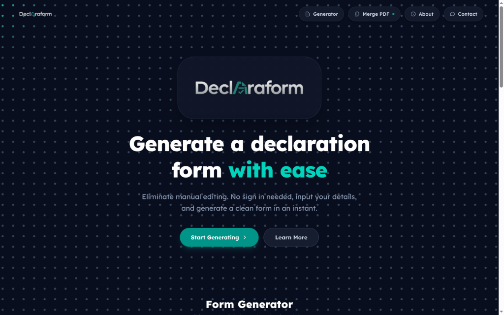
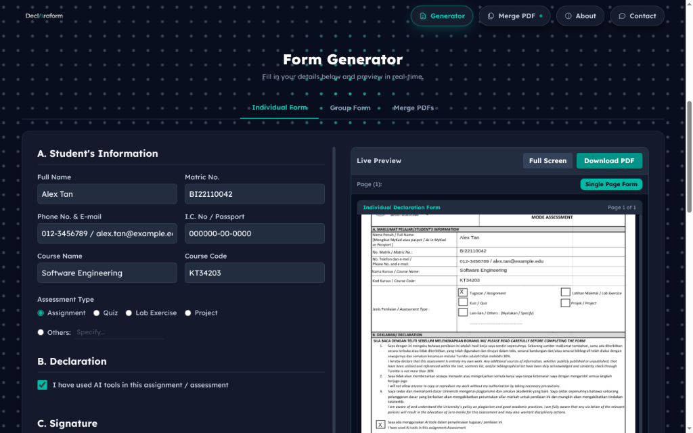
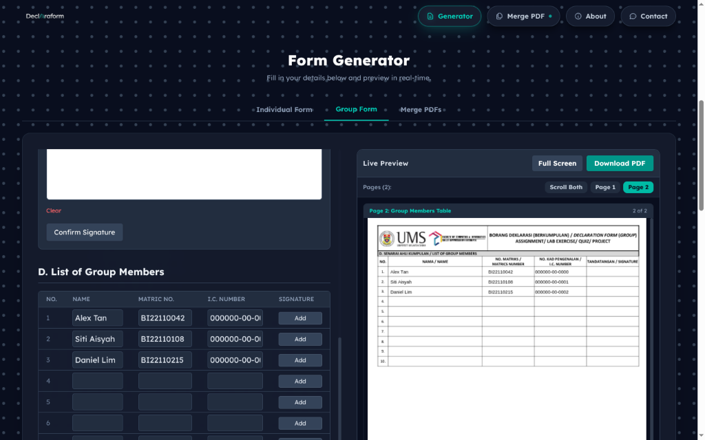
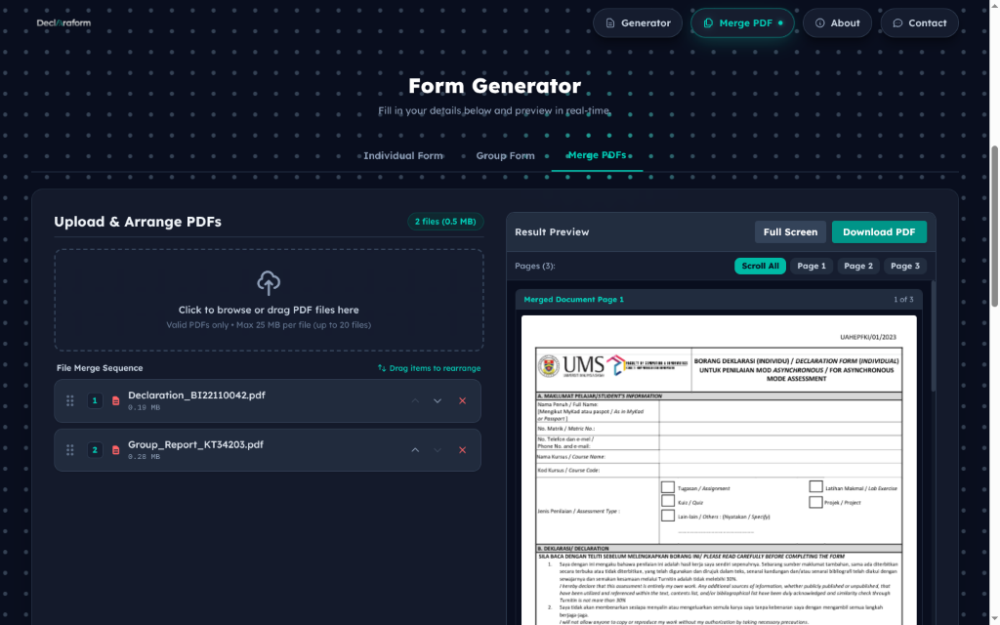

# Declaraform — FKI UMS Declaration Form Filler

**Declaraform** is a privacy-first, 100% client-side web application built for students at the **Faculty of Computing and Informatics (FKI), Universiti Malaysia Sabah (UMS)** to generate Individual and Group academic declaration forms, attach digital signatures, preview PDFs in real time, and merge multiple PDF files directly inside browser memory — with no sign-in and zero server uploads.

Live App: [https://declaraform.netlify.app/](https://declaraform.netlify.app/)



---

## Web Application Screenshots

All screenshots below are captured directly from the live running web application using synthetic sample data.

### 1. Individual Declaration Form & Real-Time PDF Preview
Two-column responsive workspace: filling in student details, assessment type, AI tool declaration, and digital signature automatically re-generates and renders the official FKI UMS Individual Declaration PDF in real time.



### 2. Group Declaration Form (Up to 10 Members)
Supports leader details, up to 10 group members with individual signature capture, and a multi-page preview switcher (`Scroll Both`, `Page 1`, `Page 2`) to inspect both the declaration page and the group member table.



### 3. Client-Side PDF Merger
Drag-and-drop PDF uploader with magic-byte validation, pointer and touch reordering, local IndexedDB caching across reloads, and live multi-page merged PDF preview.



---

## Key Features

- **Individual & Group Declaration Forms:** Automatically populates official UMS FKI PDF templates (`declarationFormIndividual.pdf` and `declarationFormGroup.pdf`) with exact coordinate placement.
- **Digital Signature Pad:** Draw signatures on a high-DPI responsive canvas or upload PNG/JPEG images (re-encoded through an offscreen HTML5 Canvas to strip EXIF metadata and neutralize polyglot files).
- **Real-Time Cross-Browser PDF Preview:** Renders PDF pages onto `<canvas>` via PDF.js without relying on native browser PDF viewers, ensuring reliable multi-page previews on desktop and mobile Safari/iOS WebKit.
- **Drag-and-Drop PDF Merger:** Merge up to 20 PDF files (25 MB max per file, 100 MB combined limit) with drag/touch sequence reordering and instant single-click download.
- **Zero-Data Privacy Architecture:** All PDF generation, signing, and merging run strictly in browser memory. Form drafts are scoped to ephemeral per-tab `sessionStorage` and vanish when the tab closes.
- **Adaptive Desktop & Mobile UI:** Features a floating glassmorphic pill top navbar on desktop and a native-style bottom navigation dock with segmented Form/Preview switchers on mobile.

---

## Tech Stack Explained

| Layer | Technology | Version | Role in This System |
| :--- | :--- | :--- | :--- |
| **UI Framework** | [React](https://react.dev/) | `^19.2.7` | Component architecture, `StrictMode`, hook-driven debounced PDF state, and safe DOM/canvas ref lifecycle management. |
| **Build & Dev Server** | [Vite](https://vite.dev/) + `@vitejs/plugin-react` | `^8.1.1` | Fast HMR dev server, production bundling (`es2020`, `safari15`, `chrome90`, sourcemaps disabled), DNS-rebinding host allowlist, and HTTP security header injection. |
| **Styling & Typography** | [Tailwind CSS v4](https://tailwindcss.com/) (`@tailwindcss/vite`) + `@fontsource-variable/lexend` | `^4.3.2` / `^5.3.0` | Utility-first dark theme (`slate-950` + `teal-400/500`) and locally bundled variable typography with zero third-party font CDN requests. |
| **PDF Generation & Merging** | [pdf-lib](https://pdf-lib.js.org/) | `^1.17.1` | Loads static PDF templates, draws WinAnsi-sanitized text and checkboxes, scales and embeds PNG/JPEG signatures, merges multi-document pages, and extracts single-page preview blobs. |
| **PDF Rendering** | [PDF.js (`pdfjs-dist`)](https://mozilla.github.io/pdf.js/) (Legacy Build) | `^6.4.299` | Renders PDF bytes onto `<canvas>` in-thread (`WorkerMessageHandler`) with `isEvalSupported: false` for strict CSP compliance and iOS WebKit stability. |
| **Signature Capture** | [`react-signature-canvas`](https://github.com/agilgur5/react-signature-canvas) | `^1.1.0-alpha.2` | Freehand pointer/touch signature drawing wrapped with `ResizeObserver` DPI scaling and stroke preservation. |
| **Schema Validation & Sanitization** | [Zod v4](https://zod.dev/) + [DOMPurify](https://github.com/cure53/DOMPurify) | `^4.6.7` / `^3.4.17` | Strict runtime input schemas (`.strip()` / `.strict()`), WinAnsi/control-character stripping, spreadsheet formula neutralization, and HTML sanitization. |
| **Animations & Background** | [GSAP](https://gsap.com/) (`ScrollTrigger`, `InertiaPlugin`) | `^3.15.0` | Reduced-motion-aware desktop scroll reveals and physics-driven interactive HTML5 Canvas `DotGrid` background with pointer repulsion and click shockwaves. |
| **Client Storage** | `sessionStorage` & `IndexedDB` | Web APIs | Ephemeral per-tab draft persistence (with quota fallback) for forms; local `IndexedDB` blob caching for PDF Merger files with magic-byte re-verification on restore. |
| **Linting & Hosting** | [Oxlint](https://oxc.rs/) & [Netlify](https://www.netlify.com/) | `^1.71.0` | High-speed linting plus static CDN deployment enforcing strict CSP, HSTS preload, and security headers via `client/public/_headers`. |

---

## How It Works Under the Hood (Code Snippets)

### 1. Client-Side PDF Generation & Signature Embedding (`pdf-lib`)
Every form change triggers a debounced (`500 ms`) PDF generation pipeline in [`client/src/features/pdfGeneration/generatePdf.js`](client/src/features/pdfGeneration/generatePdf.js). Inputs are validated through Zod, the same-origin PDF template is fetched into an `ArrayBuffer`, text is drawn onto mapped coordinates, and signatures are decoded directly from verified base64 bytes (never via `fetch()` on data URLs):

```js
// client/src/features/pdfGeneration/generatePdf.js
const embedSignature = async (pdfDoc, page, signatureDataUrl, { x, y, maxWidth, maxHeight }) => {
  if (!signatureDataUrl) return;

  // Decode base64 signature directly and verify PNG/JPEG magic bytes (never call fetch on data URLs)
  const decoded = decodeSignatureDataUrl(signatureDataUrl);
  if (!decoded) return;

  let signatureImage;
  if (decoded.format === 'png') {
    signatureImage = await pdfDoc.embedPng(decoded.bytes);
  } else if (decoded.format === 'jpeg') {
    signatureImage = await pdfDoc.embedJpg(decoded.bytes);
  }
  if (!signatureImage) return;

  const originalDims = signatureImage.scale(1);
  if (originalDims.width <= 0 || originalDims.height <= 0) return;

  const scale = Math.min(maxWidth / originalDims.width, maxHeight / originalDims.height);
  const scaledDims = signatureImage.scale(scale);

  page.drawImage(signatureImage, {
    x,
    y,
    width: scaledDims.width,
    height: scaledDims.height,
  });
};
```

```js
// client/src/features/pdfGeneration/generatePdf.js
export const generateIndividualForm = async (rawFormData) => {
  const parsed = individualFormSchema.safeParse(rawFormData);
  if (!parsed.success) return null;
  const formData = parsed.data;

  const templateResponse = await fetch(PDF_TEMPLATES.INDIVIDUAL, { credentials: 'same-origin' });
  const existingPdfBytes = await templateResponse.arrayBuffer();
  const pdfDoc = await PDFDocument.load(existingPdfBytes);
  const [firstPage] = pdfDoc.getPages();

  // A. Student's Information
  firstPage.drawText(formData.fullName, { x: 220, y: 645, ...FONT_SETTINGS });
  firstPage.drawText(formData.matricNo, { x: 220, y: 615, ...FONT_SETTINGS });
  firstPage.drawText(formData.courseName, { x: 220, y: 572, ...FONT_SETTINGS });
  firstPage.drawText(formData.courseCode, { x: 220, y: 550, ...FONT_SETTINGS });

  if (formData.usedAITools) {
    firstPage.drawText(CHECK_MARK, { x: 38, y: 225, size: CHECK_MARK_SIZE });
  }

  await embedSignature(pdfDoc, firstPage, formData.signature, {
    x: 30, y: 120, maxWidth: 150, maxHeight: 35,
  });

  const pdfBytes = await pdfDoc.save();
  return { url: createPdfBlobUrl(pdfBytes), bytes: pdfBytes };
};
```

### 2. CSP-Safe, Mobile-Compatible PDF Preview (`pdfjs-dist` Legacy + Non-Enumerable Polyfills)
Mobile browsers (especially iOS Safari and in-app WebViews) often fail on PDF `<iframe>` scrolling, module workers, or 3x Retina canvas GPU limits. [`client/src/components/common/PdfPreviewCanvas.jsx`](client/src/components/common/PdfPreviewCanvas.jsx) solves this by registering the PDF.js `WorkerMessageHandler` in-thread, disabling `eval()` for CSP compliance, and clamping canvas surface area to `4,000,000 px` (DPR capped at `2`):

```jsx
// client/src/components/common/PdfPreviewCanvas.jsx
import '../../utils/polyfills.js';
import * as pdfjsLib from 'pdfjs-dist/legacy/build/pdf.mjs';
import * as pdfjsWorker from 'pdfjs-dist/legacy/build/pdf.worker.mjs';

// Execute PDF.js in-thread to prevent module worker failures on iOS Safari & WebViews
const mainThreadWorker = { WorkerMessageHandler: pdfjsWorker.WorkerMessageHandler };
globalThis.pdfjsWorker = mainThreadWorker;
pdfjsLib.GlobalWorkerOptions.workerSrc = '';

// Inside loadPage():
loadingTask = pdfjsLib.getDocument({
  data: sourceData.slice(),
  isEvalSupported: false, // Required for strict `script-src 'self'` CSP
  useSystemFonts: true,
});

// Cap devicePixelRatio at 2 and limit canvas area to 4M pixels to prevent WebKit GPU OOM
const pixelRatio = Math.min(window.devicePixelRatio || 1, 2);
const unscaledViewport = page.getViewport({ scale: 1.0 });
let scale = (targetWidth / unscaledViewport.width) * pixelRatio;

if (unscaledViewport.width * scale * (unscaledViewport.height * scale) > MAX_CANVAS_PIXELS) {
  scale *= Math.sqrt(MAX_CANVAS_PIXELS / (unscaledViewport.width * scale * unscaledViewport.height * scale));
}
```

Supporting polyfills (`Promise.withResolvers`, `Promise.try`, `Object.hasOwn`, `.at()`, `Set.prototype.intersection`, `AbortSignal.any`, `structuredClone`) are installed via `Object.defineProperty(..., { enumerable: false })` in [`client/src/utils/polyfills.js`](client/src/utils/polyfills.js) because `pdfjs-dist` asserts zero enumerable properties on `Object.prototype` and `Array.prototype`.

### 3. Strict Input Validation, Magic-Byte Checks & Canvas Image Re-Encoding
All form fields and uploads pass through [`client/src/utils/security.js`](client/src/utils/security.js) and [`client/src/components/form/SignatureCanvas.jsx`](client/src/components/form/SignatureCanvas.jsx):

- **Binary Magic Bytes:** Uploaded PDFs must start with `%PDF-` (`25 50 44 46 2D`) and stay within 25 MB; signature images must match PNG (`89 50 4E 47 0D 0A 1A 0A`) or JPEG (`FF D8 FF`) signatures and stay within 2 MB.
- **Offscreen Canvas Re-Encoding:** Uploaded signature images are redrawn onto an offscreen `<canvas>` bounded to `600 × 240 px` and re-exported as a clean PNG data URL, stripping EXIF metadata and neutralizing image polyglots.
- **Zod Schemas & WinAnsi Filtering:** Unknown properties are stripped (`.strip()`), and text is restricted to printable WinAnsi characters before passing into `pdf-lib`.

```js
// client/src/utils/security.js
const PDF_MAGIC = [0x25, 0x50, 0x44, 0x46, 0x2d]; // "%PDF-"

export async function validatePdfUpload(file) {
  if (!file || file.size <= 0 || file.size > UPLOAD_LIMITS.MAX_PDF_BYTES) {
    return { valid: false, error: 'Each PDF file must be 25 MB or smaller.' };
  }

  const headerBytes = new Uint8Array(await file.slice(0, 5).arrayBuffer());
  if (!matchesMagicBytes(headerBytes, PDF_MAGIC)) {
    return { valid: false, error: 'File rejected: binary header does not match a valid PDF document.' };
  }

  const safeId = generateSafeUuid();
  const cleanBase = sanitizeDownloadFilename(file.name.replace(/\.pdf$/i, ''), 'Document');
  return { valid: true, safeId, safeInternalName: `${safeId}.pdf`, displayName: `${cleanBase}.pdf` };
}
```

```js
// client/src/components/form/SignatureCanvas.jsx
function sanitizeImageViaCanvas(file) {
  return new Promise((resolve, reject) => {
    const objectUrl = URL.createObjectURL(file);
    const img = new Image();
    img.onload = () => {
      URL.revokeObjectURL(objectUrl);
      const scale = Math.min(1, MAX_SIGNATURE_WIDTH / img.naturalWidth, MAX_SIGNATURE_HEIGHT / img.naturalHeight);
      const canvas = document.createElement('canvas');
      canvas.width = Math.max(1, Math.round(img.naturalWidth * scale));
      canvas.height = Math.max(1, Math.round(img.naturalHeight * scale));
      const ctx = canvas.getContext('2d');
      ctx.drawImage(img, 0, 0, canvas.width, canvas.height);

      const cleanDataUrl = canvas.toDataURL('image/png');
      isSafeSignatureDataUrl(cleanDataUrl) ? resolve(cleanDataUrl) : reject(new Error('Limit exceeded.'));
    };
    img.src = objectUrl;
  });
}
```

### 4. Ephemeral Per-Tab Draft Storage & Quota Fallback
[`client/src/hooks/useBrowserStorage.js`](client/src/hooks/useBrowserStorage.js) ensures personal details (name, matric number, IC/passport) survive accidental reloads within the current tab without persisting to disk (`localStorage`). At startup, [`client/src/main.jsx`](client/src/main.jsx) also runs `validateClientEnv()` and `purgeLegacyPiiStorage()` to scrub any legacy disk drafts:

```js
// client/src/hooks/useBrowserStorage.js
// Enforce volatile sessionStorage for declaration form drafts — never persist PII to localStorage
const effectiveType =
  type === 'local' && (key === STORAGE_KEYS.INDIVIDUAL_DRAFT || key === STORAGE_KEYS.GROUP_DRAFT)
    ? 'session'
    : type;

// On write (debounced 300ms): gracefully drop base64 signatures if sessionStorage quota is exceeded
if (safeSetItem(storage, key, serialized)) return;
if (fallbackRef.current) {
  const reduced = JSON.stringify(fallbackRef.current(value));
  if (safeSetItem(storage, key, reduced)) return;
}
```

### 5. Interactive GSAP Canvas Background & Accessible Scroll Reveals
The ambient background in [`client/src/components/backgrounds/DotGrid.jsx`](client/src/components/backgrounds/DotGrid.jsx) renders a retina-scaled grid using cached `Path2D` circles and GSAP `InertiaPlugin` for velocity-based mouse repulsion and click shockwaves. Section entrances in [`client/src/hooks/useScrollAnimations.js`](client/src/hooks/useScrollAnimations.js) use `gsap.matchMedia()` so animations are automatically bypassed when `prefers-reduced-motion: reduce` is enabled:

```js
// client/src/hooks/useScrollAnimations.js
const mm = gsap.matchMedia();

mm.add('(min-width: 1024px) and (prefers-reduced-motion: no-preference)', () => {
  gsap.from('[data-hero]', {
    opacity: 0, y: 30, duration: 0.8, ease: 'power3.out', stagger: 0.15,
    clearProps: 'transform,opacity',
  });

  const revealEls = gsap.utils.toArray('[data-reveal]');
  gsap.set(revealEls, { opacity: 0, y: 30 });
  ScrollTrigger.batch(revealEls, {
    start: 'top 95%',
    once: true,
    onEnter: (batch) =>
      gsap.to(batch, {
        opacity: 1, y: 0, duration: 0.8, ease: 'power3.out', stagger: 0.12,
        overwrite: true, clearProps: 'transform,opacity',
      }),
  });
}, scopeRef);
```

### 6. Production Security Headers
Both Vite preview ([`client/vite.config.js`](client/vite.config.js)) and Netlify production ([`client/public/_headers`](client/public/_headers)) enforce strict transport, framing, permission, and content security policies:

```text
/*
  Content-Security-Policy: default-src 'self'; script-src 'self'; style-src 'self' 'unsafe-inline'; img-src 'self' data: blob:; font-src 'self' data:; connect-src 'self' blob: https://script.google.com https://script.googleusercontent.com; frame-src 'self' blob:; worker-src 'self' blob:; object-src 'self' blob:; frame-ancestors 'none'; base-uri 'self'; form-action 'self'; upgrade-insecure-requests
  Strict-Transport-Security: max-age=63072000; includeSubDomains; preload
  X-Content-Type-Options: nosniff
  X-Frame-Options: DENY
  Referrer-Policy: strict-origin-when-cross-origin
  Permissions-Policy: camera=(), microphone=(), geolocation=(), payment=(), usb=()
```

---

## Project Structure

```text
declaration-form-filler/
├── docs/
│   └── screenshots/                    # Real screenshots of the live web application
│       ├── hero.png
│       ├── individual-form.png
│       ├── group-form.png
│       └── pdf-merger.png
└── client/
    ├── index.html                      # Document shell & Open Graph / Twitter metadata
    ├── package.json                    # Dependencies and npm scripts
    ├── vite.config.js                  # Vite 8 config, CSP headers, and host allowlist
    ├── public/
    │   ├── _headers                    # Netlify production HTTP security headers
    │   ├── logo.png                    # Application branding
    │   └── templates/
    │       ├── declarationFormIndividual.pdf
    │       └── declarationFormGroup.pdf
    └── src/
        ├── main.jsx                    # Entry point, polyfills, startup env & PII audit
        ├── App.jsx                     # Layout, responsive nav state, feedback form
        ├── index.css                   # Tailwind CSS v4 import & Lexend font theme
        ├── components/
        │   ├── backgrounds/            # Interactive GSAP Canvas DotGrid
        │   ├── common/
        │   │   └── PdfPreviewCanvas.jsx # In-thread PDF.js canvas renderer
        │   ├── form/
        │   │   └── SignatureCanvas.jsx # DPI-aware drawing pad & image sanitizer
        │   └── layout/
        │       ├── Navbar.jsx          # Desktop floating pill navigation
        │       └── BottomNav.jsx       # Mobile app-dock bottom navigation
        ├── features/
        │   ├── individualForm/
        │   │   └── IndividualForm.jsx  # Single-student form + live preview
        │   ├── groupForm/
        │   │   └── GroupForm.jsx       # 10-member group form + 2-page preview
        │   ├── pdfMerger/
        │   │   └── PdfMerger.jsx       # Drag/touch PDF uploader, sorter & merger
        │   └── pdfGeneration/
        │       └── generatePdf.js      # pdf-lib coordinate writer & multi-PDF merger
        ├── hooks/
        │   ├── useBrowserStorage.js    # Sanitized ephemeral sessionStorage hook
        │   └── useScrollAnimations.js  # GSAP ScrollTrigger reduced-motion hook
        └── utils/
            ├── constants.js            # Template paths, categories & storage keys
            ├── pdfStorage.js           # IndexedDB persistence for PDF Merger
            ├── polyfills.js            # Non-enumerable ES/Web API polyfills
            └── security.js             # Zod schemas, magic bytes, rate limiter & URL guards
```

---

## Security & Privacy Highlights

- **Zero-Upload PDF Pipeline:** Student details, matric numbers, signatures, and uploaded PDFs are processed exclusively in client-side memory.
- **No Raw HTML Injection:** Zero use of `dangerouslySetInnerHTML`, `eval()`, or `new Function()`. External links and `blob:` preview URLs are verified against strict protocol/origin allowlists (`isSafeExternalUrl`, `isSafeBlobUrl`).
- **Feedback Protection:** The optional feedback form validates payloads with a strict Zod schema, caps payload size at `4 KB`, neutralizes spreadsheet formula prefixes (`=`, `+`, `-`, `@`), enforces an in-memory sliding-window rate limit (`3` submissions / `10 min`, `30 s` cooldown), and restricts submission hosts to HTTPS `script.google.com` / `script.googleusercontent.com` with `credentials: 'omit'` and `referrerPolicy: 'no-referrer'`.
- **Safe Error Handling:** Detailed diagnostics are logged only when `import.meta.env.DEV` is true (`logSafeError`); production builds disable sourcemaps and show generic user-facing error messages.

---

## Getting Started

### Prerequisites
- [Node.js](https://nodejs.org/) `v20+`
- `npm`

### Local Development

```bash
# 1. Clone the repository
git clone https://github.com/ElXprogramming/Declaraform.git
cd Declaraform/client

# 2. Install dependencies
npm install

# 3. Start the Vite development server (http://localhost:5173)
npm run dev
```

### Available Scripts (inside `client/`)

| Command | Description |
| :--- | :--- |
| `npm run dev` | Starts the Vite dev server on port `5173` with HMR and dev security headers. |
| `npm run build` | Builds the optimized production bundle into `client/dist/` (sourcemaps disabled). |
| `npm run preview` | Serves `client/dist/` locally on port `4173` with production CSP headers. |
| `npm run lint` | Runs `oxlint` static analysis across the client codebase. |

### Optional Environment Variable
To override the public Google Apps Script endpoint used by the optional feedback form, create `client/.env.local` (ignored by Git):

```env
VITE_FEEDBACK_ENDPOINT_URL=https://script.google.com/macros/s/<your-deployment-id>/exec
```

> **Note:** Never prefix private keys, tokens, or secrets with `VITE_`. `validateClientEnv()` audits `import.meta.env` on startup and blocks forbidden secret key patterns from being exposed to the client bundle.

---

## Author

Created by **Eldion Ryan Godius**
- Portfolio: [eldionryanportfolio.vercel.app](https://eldionryanportfolio.vercel.app)
- GitHub: [@ElXprogramming](https://github.com/ElXprogramming)
- LinkedIn: [Eldion Ryan Godius](https://www.linkedin.com/in/eldion-ryan-godius-897064235)
